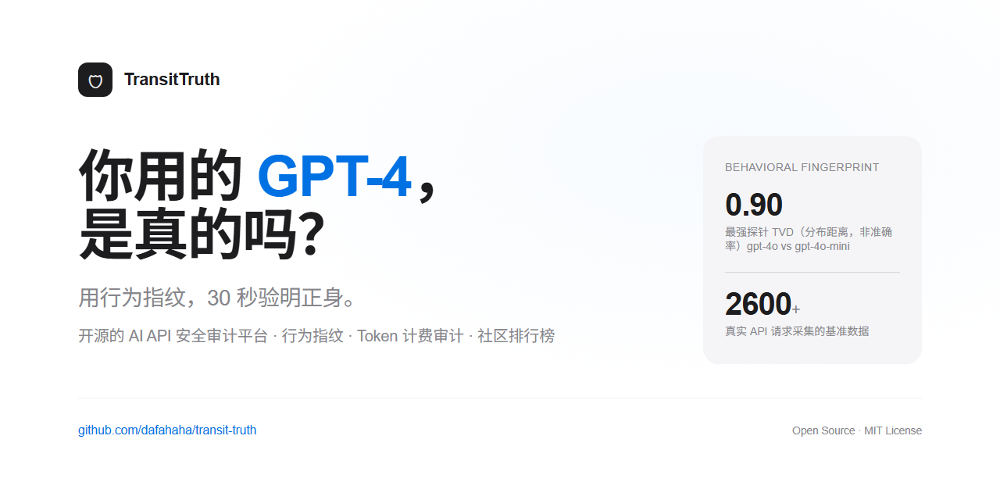

# TransitTruth 🛡️

[English](README.en.md) · [中文](README.md)



**You pay for `gpt-4o-mini` at an API relay. Are you actually getting it?**
TransitTruth is a stateless CLI that probes any OpenAI-compatible endpoint with a bounded battery of fingerprint probes and tells you, in one JSON report, whether the model it claims to serve matches the reference fingerprint.

Built for LLM-security researchers, agent developers, and anyone who routes LLM traffic through third-party relays or gateways.

---

## Quickstart

```bash
pip install transit-truth
# for the self-hosted reference-server's REAL local tokenizer (the no-key path
# below degrades to an honest plumbing stub without this extra):
pip install "transit-truth[reference]"
```

Point it at a relay and the model it claims to serve. The API key is read from
the environment — it never touches disk, logs, or the report.

```bash
export TRANSIT_TRUTH_API_KEY=sk-your-key
transit-truth verify --base-url https://your-relay.com/v1 --model gpt-4o-mini
```

Stdout is a single machine-readable JSON report:

```json
{
  "claimed_model": "gpt-4o-mini",
  "verdict": "pass",
  "confidence": "medium",
  "statistics": {
    "matched_reference_model": "gpt-4o-mini",
    "posterior": 0.87,
    "tokenizer_consistency": {"score": 1.0, "verdict": "match"}
  },
  "disclaimer": "Probabilistic auxiliary evidence, NOT a cryptographic proof."
}
```

Exit codes: `0` for `pass` **or** `insufficient_evidence`, `3` for
`suspicious`, `2` for an execution error. Script against the JSON `verdict`
field, not the exit code.

### No paid key? Run the whole pipeline locally

Ships with a self-hosted, OpenAI-compatible reference backend. The verify
client requires a non-empty key, so just set a dummy value:

```bash
export TRANSIT_TRUTH_API_KEY=local-dummy-no-billing   # never billed, local only

# terminal 1: local reference backend (real Qwen tokenizer counts,
# deterministic stub content; no real model, no GPU needed)
transit-truth reference-server --model qwen2.5-0.5b-instruct --port 8765

# terminal 2: verify it against itself
transit-truth verify --base-url http://127.0.0.1:8765/v1 \
    --model qwen2.5-0.5b-instruct --allow-local
```

`--allow-local` is required for loopback targets; the default enforces a
public-URL SSRF guard. If the real tokenizer cannot be downloaded
(`HF_ENDPOINT` defaults to `https://hf-mirror.com`), the reference-server
degrades to an explicitly labelled plumbing stub — the stderr banner and
`GET /v1/models` `mode` field say so loudly, and it cannot certify anything.

## The three verdicts

| verdict | meaning |
|---|---|
| `pass` | observed fingerprint is statistically consistent with the reference. |
| `suspicious` | observed fingerprint differs significantly (e.g. wrong model family). |
| `insufficient_evidence` | no reference, sample too small, or the endpoint refused to cooperate — we do **not** guess. |

A `suspicious` verdict is not "proven fraud". It is evidence that deserves a
closer look.

## What it actually does

Given a claimed model, the default battery sends 17 requests: 5 tokenizer
probes (self-reported `usage.prompt_tokens` on a fixed prompt suite) and 4
behavioral probes × 3 repeats (distributional "random task" preferences —
which number, coin flip, animal, letter a model returns). It compares the
observed fingerprint against the shipped reference catalog using chi-square /
KS tests and a Bayesian posterior, and returns a single report. The whole run
costs under $0.01.

## Honest limitations

Read this before trusting any verdict.

- **Probabilistic auxiliary evidence, not a cryptographic proof.** Black-box
  fingerprints can be faked; provider-signed responses (official
  attestations) remain the only endgame. This tool is a cheap, repeatable
  screening layer, not a court witness.
- **Coverage is narrow, by design.** Shipped references today:
  - `gpt-4o-mini` and `gpt-4o` — n=50 baselines collected through a **single
    third-party relay (wolfai.top), not the official OpenAI endpoint**. We
    claim only that those two named endpoints were distinguishable at that
    relay, not a vendor-independent fingerprint.
  - Qwen2.5-0.5B-Instruct — real local tokenizer counts only, **no behavioral
    distribution**, so it can never yield a `pass` on its own.
  - DeepSeek-R1-Distill-Qwen — derives the Qwen2 tokenizer; counts cannot
    distinguish it from Qwen. GLM is catalogued but pending tokenizer
    download.
  - Closed-model fingerprints for Claude / Gemini / other GPT claims need
    your own keys to collect.
- **Temperature=0 point-mass replay risk.** The shipped behavioral baselines
  are degenerate distributions (e.g. gpt-4o-mini returns "7" for "pick a
  number 1–10" every single time). The probe prompts and baselines ship in
  this public repo, so an adversary can hard-code the ~4 public modal strings
  and reproduce a behavioral "match" deterministically. The report flags
  `deterministic_replay_risk` for exactly this and caps confidence at `low`.
- **Tokenizer counts are a weak, self-reported signal.** A relay controls the
  numbers it reports. Different families can also be nearly identical on the
  public probes (Qwen2.5 vs o200k agree on 4 of 5 probes). Behavioral
  evidence is the primary judge; never infer a model family from tokenizer
  agreement alone.
- **ε-dilution.** A relay that routes only a fraction of traffic to a fake
  model is hard to detect within a small budget.
  `app.verify.sequential.budgeted_sequential_analysis(epsilon, budget)` helps
  you estimate what your budget can catch.

See [docs/verify.md](docs/verify.md) for the full report contract and
[docs/tech_report.pdf](docs/tech_report.pdf) for methodology and threat model.

## Python SDK and observability

```python
from app.verify import verify_endpoint_sync

report = verify_endpoint_sync(
    base_url="https://relay.example/v1", claimed_model="gpt-4o-mini"
)
```

Optional: OpenTelemetry / OpenInference exporter, DeepEval metric, and
Langfuse score integrations under [`examples/`](examples/).

## Repository layout beyond the CLI

This repo also ships the broader audit platform it grew out of: a FastAPI web
UI for relay auditing, a community leaderboard, the collected baseline
datasets, and an extended technical report.

- **Online demo (zero install):** https://dafahaha.github.io/transit-truth/
  — runs entirely in the browser, key never touches a server.
- **Run the web platform:** `cd backend && pip install -r requirements.txt && uvicorn app.main:app --port 8000`
- **Docker:** `docker-compose up -d` (see README for UID/proxy notes).
- **Baseline data:** `data/baselines/` (real n=50 collections),
  `data/fingerprints/` (open-source tokenizer catalog).
- **Tests:** 249 passed / 7 skipped (the 7 skipped are integration tests
  that need a real API key; run them with `pytest -m integration`).

## Installing from source (before the PyPI release)

```bash
git clone https://github.com/dafahaha/transit-truth.git
cd transit-truth
pip install .
# for the real local tokenizer in reference-server:
pip install ".[reference]"
```

If you change `data/baselines/` or `data/fingerprints/`, run
`python sync_reference_data.py` before building a wheel — the installed
package carries a mirror of that catalog.

## Contributing

Issues and PRs welcome. Good first issues are tagged
[`good first issue`](https://github.com/dafahaha/transit-truth/labels/good%20first%20issue):
adding a new open-source model tokenizer fingerprint, an OTel exporter
example, or translated docs. See [CONTRIBUTING.md](CONTRIBUTING.md) and
[CODE_OF_CONDUCT.md](CODE_OF_CONDUCT.md).

If you audit a relay, post the result in
[Discussions → Show your audit results](https://github.com/dafahaha/transit-truth/discussions).

## Citation

```bibtex
@misc{transittruth2026,
  title  = {TransitTruth: Stateless Verification of Model Identity for OpenAI-Compatible Endpoints},
  author = {dafahaha},
  year   = {2026},
  howpublished = {\url{https://github.com/dafahaha/transit-truth}},
}
```

## Disclaimer

Research tooling. Results are statistical evidence, not legal proof. Respect
the target service's terms of use; do not hammer endpoints. This project is
not affiliated with OpenAI, Qwen, or any model provider.

## License

MIT — see [LICENSE](LICENSE).
