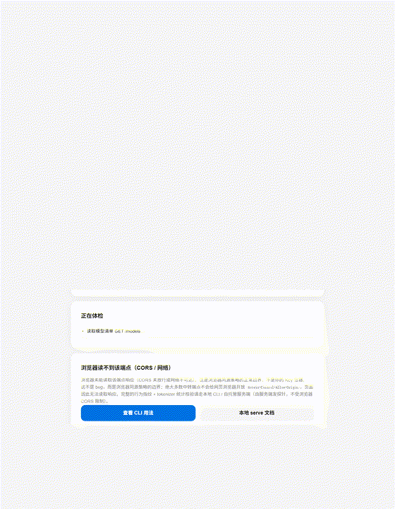
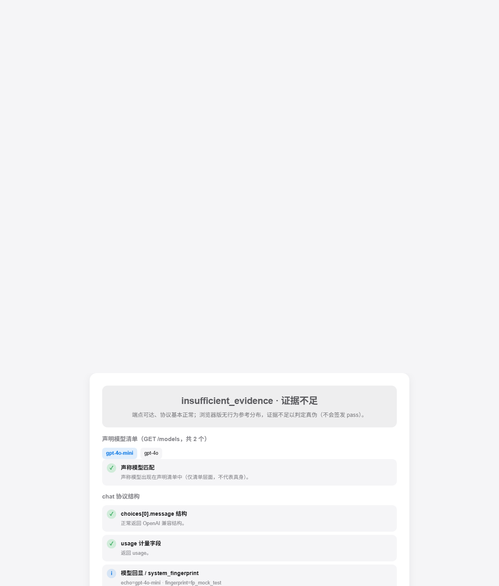
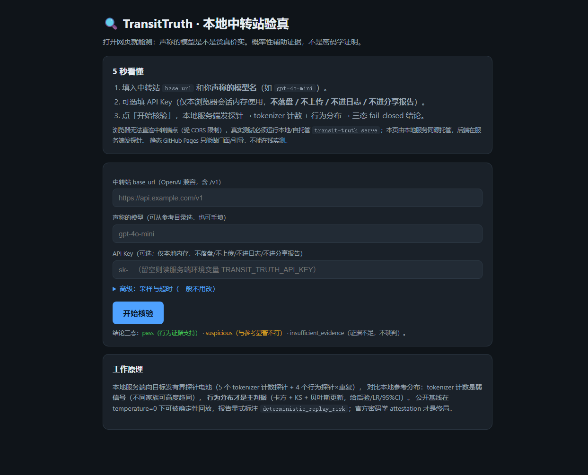
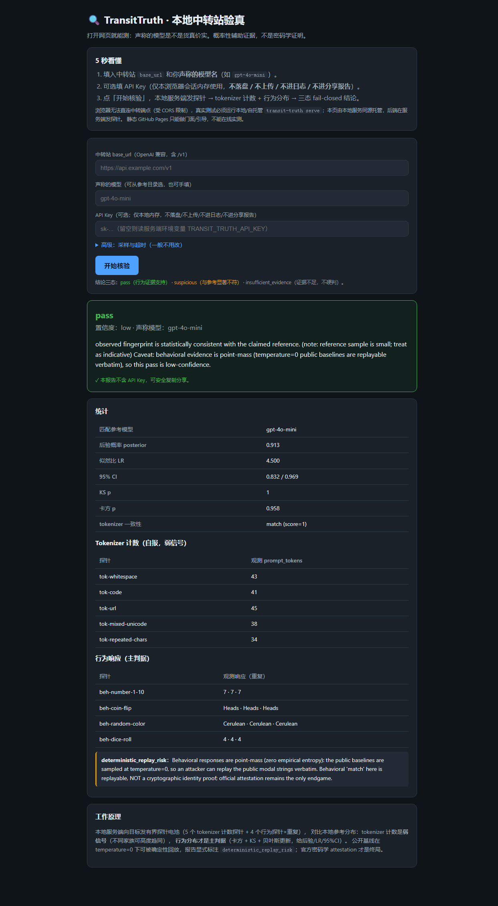
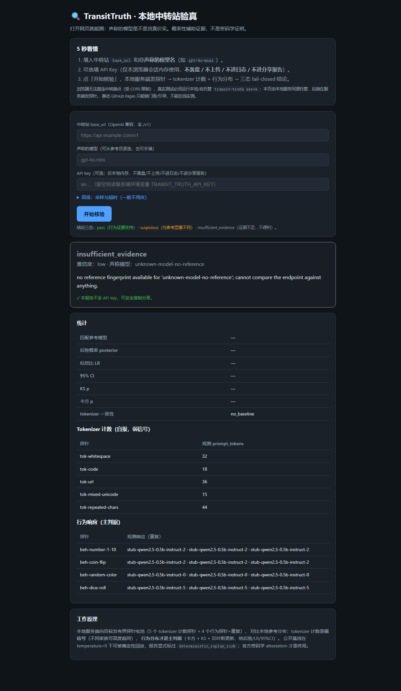
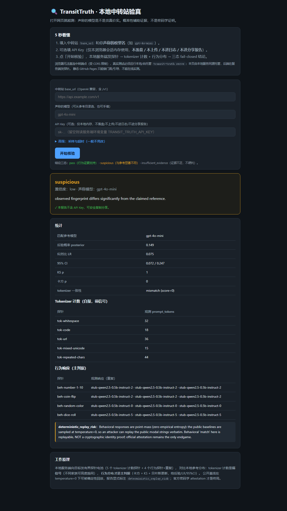

# TransitTruth 🛡️

[English](README.en.md) · [中文](README.md)


**You pay for `gpt-4o-mini` at an API relay. Are you actually getting it?**
TransitTruth is a stateless CLI that probes any OpenAI-compatible endpoint with a bounded battery of fingerprint probes and tells you, in one JSON report, whether the model it claims to serve matches the reference fingerprint. It also ships a local single-page web UI (`transit-truth serve`) so you can run the same check from a browser on your own machine.

Built for LLM-security researchers, agent developers, and anyone who routes LLM traffic through third-party relays or gateways.

> **Scope note.** The bundled current `verify`/`serve` path (the code path intended for PyPI; not yet published) is **stateless model-identity verification** (CLI/SDK + local `serve` browser UI; the key stays in session memory only). Token billing audit (tiktoken token-billing difference detection), latency/availability/error-rate performance monitoring, OpenAI response-format protocol compliance, balance queries/low-balance alerts, continuous monitoring/alert channels, and a community leaderboard/online submissions belong to an **early, standalone legacy web platform (`app.main`, self-hosted separately)** and are **NOT** part of the current `verify`/`serve`/PyPI bundle.

---

## 🌐 One-click online check (no install, open the page)

No Python needed: open the GitHub Pages build, paste your own relay Base URL (optional temporary/low-quota key), and let **your browser talk straight to the endpoint you typed** for a reachability / protocol / basic-capability liveness check with a fail-closed three-state report. The key lives only in page memory and goes directly to your own endpoint: **it never touches this project's servers, is never stored, never enters the URL, never hits logs**.

**Online URL:** <https://dafahaha.github.io/transit-truth/docs/online/index.html>





**Limits, read first:** browsers are CORS-restricted, so most relays cannot be read from a web page (the page honestly tells you to use the CLI/local serve); the browser has no behavioral reference distribution and cannot run tiktoken BPE counting, so **the online build never emits `pass`**. Full behavioral fingerprint + tokenizer statistics still require local `transit-truth serve` / CLI. Online output is probabilistic auxiliary evidence, not a cryptographic proof.

---

## Quickstart

> **PyPI is not published yet.** There is no `pip install transit-truth` from
> PyPI yet (a `pip install transit-truth` today would 404). Install from source:

```bash
git clone https://github.com/dafahaha/transit-truth.git
cd transit-truth
pip install .
# for the self-hosted reference-server's REAL local tokenizer (the no-key path
# below degrades to an honest plumbing stub without this extra):
pip install ".[reference]"
```
<!-- PYPI-FLIP: switch this block back to `pip install transit-truth` +
`pip install "transit-truth[reference]"` only once the package is actually on PyPI. -->


Point it at a relay and the model it claims to serve. The API key is read from
the environment — it never touches disk, logs, or the report.

```bash
export TRANSIT_TRUTH_API_KEY=sk-your-key
transit-truth verify --base-url https://your-relay.com/v1 --model gpt-4o-mini
```

Stdout is a single machine-readable JSON report:

```json
{
  "claimed_model": "gpt-4o-mini",
  "verdict": "pass",
  "confidence": "medium",
  "statistics": {
    "matched_reference_model": "gpt-4o-mini",
    "posterior": 0.87,
    "tokenizer_consistency": {"score": 1.0, "verdict": "match"}
  },
  "disclaimer": "Probabilistic auxiliary evidence, NOT a cryptographic proof."
}
```

Exit codes: `0` for `pass` **or** `insufficient_evidence`, `3` for
`suspicious`, `2` for an execution error. Script against the JSON `verdict`
field, not the exit code.

## Local web UI (`transit-truth serve`)

For a point-and-click check, start the local server and open the browser:

```bash
transit-truth serve                 # default http://127.0.0.1:8766
transit-truth serve --open          # open the browser automatically
```

The UI serves itself and a `POST /api/verify` endpoint from one local process;
the server runs the probe battery. Fill in the relay `base_url`, the claimed
model (pick from the catalog or type it), and optionally your key (a password
field). The report banner shows the three-state verdict, confidence, posterior /
LR / 95% CI / chi-square / KS p, per-probe evidence, and flags
(`deterministic_replay_risk`, `thin_evidence`, `non_cooperation`).

**Local web UI screenshots** (captured from a local `transit-truth serve` against
local stub backends; no real key; the report contains no key):

| Home form | pass (behavioral evidence supports) | insufficient_evidence (not enough evidence, no forced verdict) | suspicious (differs significantly from reference) |
| --- | --- | --- | --- |
|  |  |  |  |

### Key safety (hard contract)

- The key lives in **memory only** for the session: it is never written to
  disk, never logged (including uvicorn access log), never echoed in the
  response, and never appears in a shareable report.
- A defense-in-depth `sanitize_report` recursively strips credential fields
  (`api_key / authorization / bearer / key`) and redacts `sk-...` /
  `Bearer ...` strings before replying. The report page states it contains no
  key and may be shared safely.
- Default bind is `127.0.0.1` (loopback only). Binding a non-loopback address
  (`0.0.0.0`, `::`, RFC1918, public IP, or a hostname) requires the explicit
  `--allow-public` flag; the server also enforces same-origin, `Sec-Fetch-Site`,
  Content-Type (`application/json` only), and (on loopback) a Host whitelist to
  block DNS-rebinding and cross-site calls.

### Why the hosted Pages site cannot test a real relay (CORS)

A browser on a static GitHub Pages site cannot call a third-party relay
directly: the relay returns no CORS headers, so the request fails with an
ambiguous `Failed to fetch`, and a browser should never be asked to send your
key to the target domain. **Real model-identity verification must run through
the local/self-hosted `serve` server** (or the CLI), because the server — not
the browser — sends the probes.

### Deployment boundaries (honest)

- **Docker / VPS:** `Dockerfile.serve` + `docker-compose.serve.yml` publish
  only host `127.0.0.1:8766:8766`; put Caddy/Nginx + TLS in front for a public
  VPS. Note the container listens on `0.0.0.0` inside its own private network
  namespace (docker bridge reaches eth0, not container loopback); the exposure
  boundary stays on the host side and must never publish `0.0.0.0:8766`.
- **Cloudflare Pages / GitHub Pages** can only host a static facade/guide.
  **Cloudflare Workers run on a V8 isolate and cannot execute the Python
  verification engine** (tiktoken, scipy, the async battery). A live backend
  needs a Python-capable VPS or container; a thin JS proxy that only forwards
  probes without statistics is not implemented here and is not claimed.
- See [docs/serve.md](docs/serve.md) for network model, troubleshooting, and
  public-hosting responsibility (do not log keys).

### No paid key? Run the whole pipeline locally

Ships with a self-hosted, OpenAI-compatible reference backend. The verify
client requires a non-empty key, so just set a dummy value:

```bash
export TRANSIT_TRUTH_API_KEY=local-dummy-no-billing   # never billed, local only

# terminal 1: local reference backend (real Qwen tokenizer counts,
# deterministic stub content; no real model, no GPU needed)
transit-truth reference-server --model qwen2.5-0.5b-instruct --port 8765

# terminal 2: verify it against itself
transit-truth verify --base-url http://127.0.0.1:8765/v1 \
    --model qwen2.5-0.5b-instruct --allow-local
```

`--allow-local` is required for loopback targets; the default enforces a
public-URL SSRF guard. If the real tokenizer cannot be downloaded
(`HF_ENDPOINT` defaults to `https://hf-mirror.com`), the reference-server
degrades to an explicitly labelled plumbing stub — the stderr banner and
`GET /v1/models` `mode` field say so loudly, and it cannot certify anything.

## The three verdicts

| verdict | meaning |
|---|---|
| `pass` | observed fingerprint is statistically consistent with the reference (behavioral evidence supports it; high confidence requires posterior > 0.9 and 95% CI lower bound > 0.7). |
| `suspicious` | observed fingerprint differs significantly (e.g. wrong model family; a tokenizer mismatch to a different family also raises this). |
| `insufficient_evidence` | no reference, sample too small, tokenizer match alone without behavioral support, or the endpoint refused to cooperate — we do **not** guess. |

A `suspicious` verdict is not "proven fraud". It is evidence that deserves a
closer look.

## What it actually does

Given a claimed model, the default battery sends a bounded set of tokenizer
probes (self-reported `usage.prompt_tokens` on a fixed prompt suite) and
behavioral probes × repeats (distributional "random task" preferences — which
number, coin flip, color, dice a model returns). It compares the observed
fingerprint against the shipped reference catalog using chi-square /
KS tests and a Bayesian posterior, and returns a single report. At low public
list prices a full run estimates under $0.01; the actual cost depends on the
model tier and per-token price (the code contains no pricing logic).

### What the shipped reference data shows

Numbers from the first catalog (gpt-4o / gpt-4o-mini, n=50 per probe, collected
through a single third-party relay — not the official endpoint):

- On the "pick a random animal" behavioral probe, gpt-4o returned **"Okapi" 76%**
  of the time (uniform choice would be ~16%).
- The simple "is the answer Okapi" rule achieves **88% resubstitution accuracy**
  on the same benchmark sample (Wilson 95% CI [0.80, 0.93]). This is an
  **in-distribution resubstitution** self-consistency check, **not** held-out
  accuracy.
- The strongest behavioral probe (random animal) reaches **TVD = 0.90** — a
  distribution distance, not a classification accuracy.
- The end-to-end pipeline self-consistency posterior is **0.913** (95% CrI
  [0.885, 0.937]) — again measured against the catalog's own in-distribution
  reference, not on independent held-out data.

These are shipped as reference fingerprints; the tool deliberately does not
claim held-out generalization or vendor-independent detection.

## Honest limitations

Read this before trusting any verdict.

- **Probabilistic auxiliary evidence, not a cryptographic proof.** Black-box
  fingerprints can be faked; provider-signed responses (official
  attestations) remain the only endgame. arXiv:2504.04715 (Berkeley) instead
  proposes TEE-based cryptographic integrity attestation — a formal/hardware
  route, not a commercial field measurement. This tool is a cheap, repeatable
  screening layer, not a court witness.
- **Coverage is narrow, by design.** Shipped references today:
  - `gpt-4o-mini` and `gpt-4o` — n=50 baselines collected through a **single
    third-party relay (wolfai.top), not the official OpenAI endpoint**. We
    claim only that those two named endpoints were distinguishable at that
    relay, not a vendor-independent fingerprint.
  - Qwen2.5-0.5B-Instruct — real local tokenizer counts only, **no behavioral
    distribution**, so it can never yield a `pass` on its own.
  - DeepSeek-R1-Distill-Qwen — derives the Qwen2 tokenizer; counts cannot
    distinguish it from Qwen. GLM is catalogued but pending tokenizer
    download.
  - Closed-model fingerprints for Claude / Gemini / other GPT claims need
    your own keys to collect.
- **Tokenizer signal, precisely.** A tokenizer **match without behavioral
  reference** only means same-family and caps at `insufficient_evidence` (it
  can never become `pass`); a tokenizer **mismatch (wrong family)** raises
  `suspicious` and zeroes posterior/LR/CI/chi-square to avoid contradiction.
  A missing tokenizer signal, or a pass/low that only replays public modal
  strings, only proves the endpoint can replay a public fingerprint — it does
  **not** equal confirming the real model; a genuine model claim rests on
  sufficient behavioral evidence at high confidence.
- **Temperature=0 point-mass replay risk.** The shipped behavioral baselines
  are degenerate distributions (e.g. gpt-4o-mini returns "7" for "pick a
  number 1–10" every single time). The probe prompts and baselines ship in
  this public repo, so an adversary can hard-code the ~4 public modal strings
  and reproduce a behavioral "match" deterministically. The report flags
  `deterministic_replay_risk` for exactly this and caps confidence at `low`.
- **Tokenizer counts are a weak, self-reported signal.** A relay controls the
  numbers it reports. Different families can also be nearly identical on the
  public probes (Qwen2.5 vs o200k agree on 4 of 5 probes). Behavioral
  evidence is the primary judge; never infer a model family from tokenizer
  agreement alone.
- **ε-dilution.** A relay that routes only a fraction of traffic to a fake
  model is hard to detect within a small budget.
  `app.verify.sequential.budgeted_sequential_analysis(epsilon, budget)` helps
  you estimate what your budget can catch.

See [docs/verify.md](docs/verify.md) for the full report contract and
[docs/tech_report.pdf](docs/tech_report.pdf) for methodology and threat model.

## Python SDK and observability

```python
from app.verify import verify_endpoint_sync

report = verify_endpoint_sync(
    base_url="https://relay.example/v1", claimed_model="gpt-4o-mini"
)
```

Optional: OpenTelemetry / OpenInference exporter, DeepEval metric, and
Langfuse score integrations under [`examples/`](examples/).

## Repository layout beyond the CLI

This repo also retains the broader audit platform it grew out of. Those
features are **legacy, self-hosted separately**, and are NOT bundled with the
current `verify`/`serve`/PyPI model-identity path:

- **Offline browser demo (root `index.html`):**
  https://dafahaha.github.io/transit-truth/ — an offline, built-in
  illustration of the audit flow with demo seed data; it needs no key and is
  not a live measurement of a real relay. Real model-identity verification
  uses `transit-truth serve` / the CLI (see CORS note above).
- **Run the local verify web UI:** `transit-truth serve` (default
  127.0.0.1:8766; see [docs/serve.md](docs/serve.md)).
- **Run the legacy web platform (separate, self-hosted):**
  `cd backend && pip install -r requirements.txt && uvicorn app.main:app --port 8000`.
  This legacy platform includes balance-query aggregation, continuous
  monitoring/alerts, and the community leaderboard; it does NOT ship with
  `verify`/`serve`/PyPI. **Public-binding risk:** it defaults to loopback;
  exposing it on a public interface requires explicit `--allow-public` and you
  are responsible for authentication, exposure, and key hygiene yourself —
  do not publish it unauthenticated. The legacy `docker-compose.yml` +
  `Dockerfile` (same legacy API, no authentication) is SUPERSEDED by
  `Dockerfile.serve` / `docker-compose.serve.yml`; it publishes only on host
  `127.0.0.1:8000` and must NOT be exposed to a LAN or the public internet.
- **Docker:** `docker compose -f docker-compose.serve.yml up -d --build` (host
  loopback only; see [docs/serve.md](docs/serve.md)).
- **Baseline data:** `data/baselines/` (real n=50 collections),
  `data/fingerprints/` (open-source tokenizer catalog).
- **Tests:** 371 passed / 7 skipped (378 collected; the 7 skipped are integration
  tests that need a real API key; run them with `pytest -m integration`).

## Installing from source (before the PyPI release)

```bash
git clone https://github.com/dafahaha/transit-truth.git
cd transit-truth
pip install .
# for the real local tokenizer in reference-server:
pip install ".[reference]"
```

If you change `data/baselines/` or `data/fingerprints/`, run
`python sync_reference_data.py` before building a wheel — the installed
package carries a mirror of that catalog.

## Contributing

Issues and PRs welcome. Good first issues are tagged
[`good first issue`](https://github.com/dafahaha/transit-truth/labels/good%20first%20issue):
adding a new open-source model tokenizer fingerprint, an OTel exporter
example, or translated docs. See [CONTRIBUTING.md](CONTRIBUTING.md) and
[CODE_OF_CONDUCT.md](CODE_OF_CONDUCT.md).

If you audit a relay, post the result in
[Discussions → Show your audit results](https://github.com/dafahaha/transit-truth/discussions).

## Citation

```bibtex
@misc{transittruth2026,
  title  = {TransitTruth: Stateless Verification of Model Identity for OpenAI-Compatible Endpoints},
  author = {dafahaha},
  year   = {2026},
  howpublished = {\url{https://github.com/dafahaha/transit-truth}},
}
```

## Disclaimer

Research tooling. Results are statistical evidence, not legal proof. Respect
the target service's terms of use; do not hammer endpoints. This project is
not affiliated with OpenAI, Qwen, or any model provider.

## License

MIT — see [LICENSE](LICENSE).
