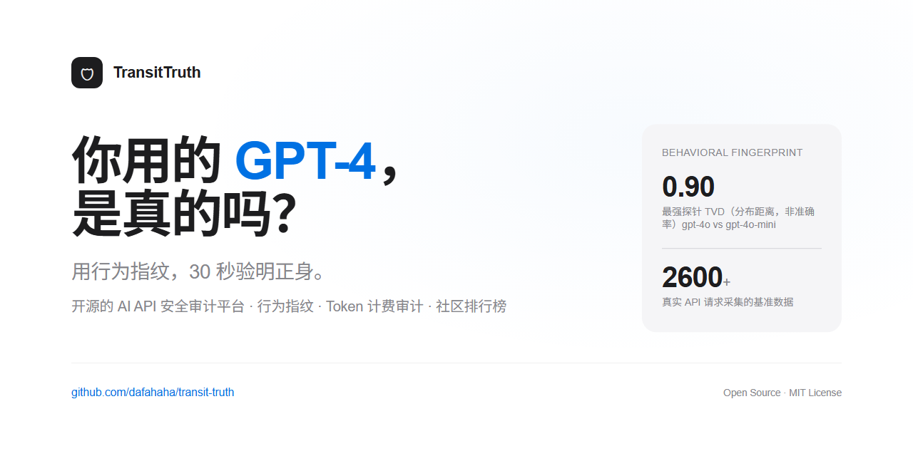
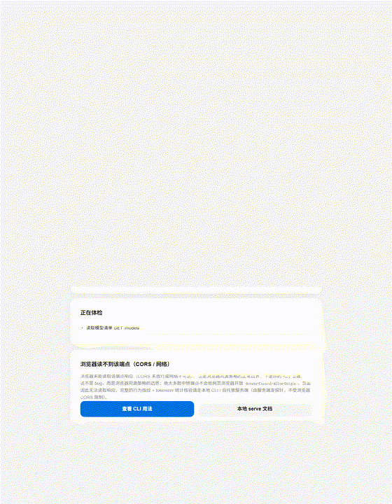
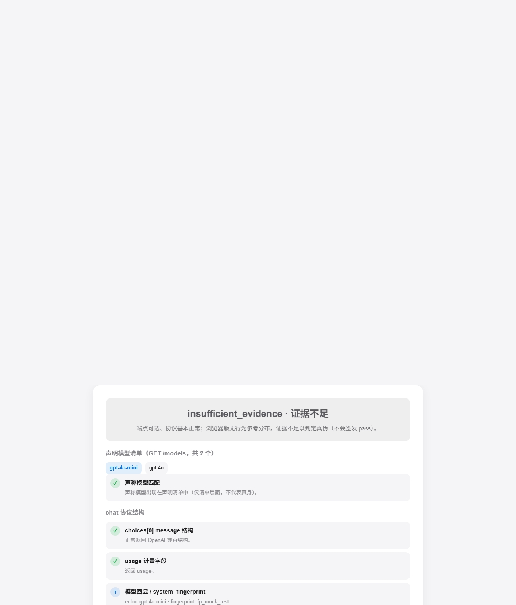
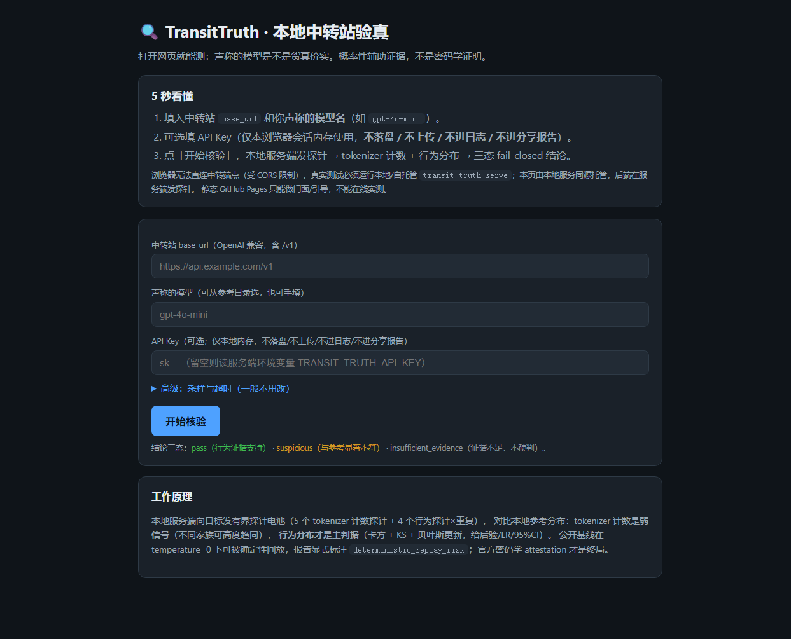
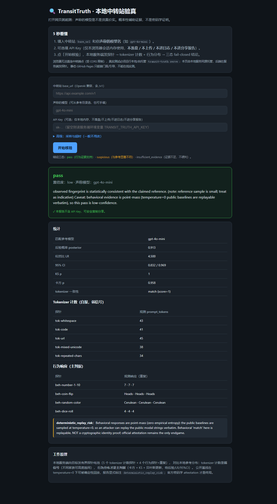
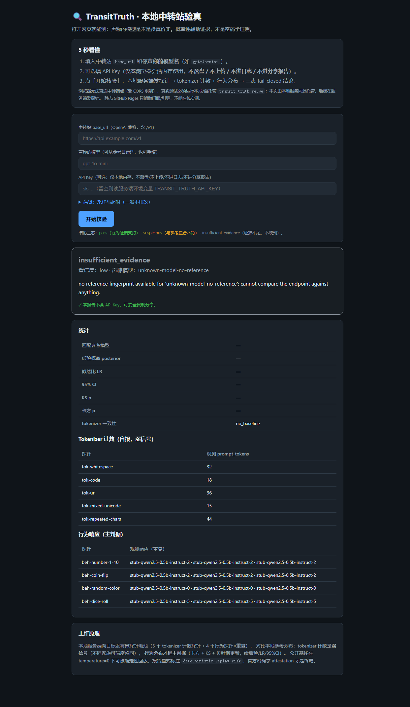
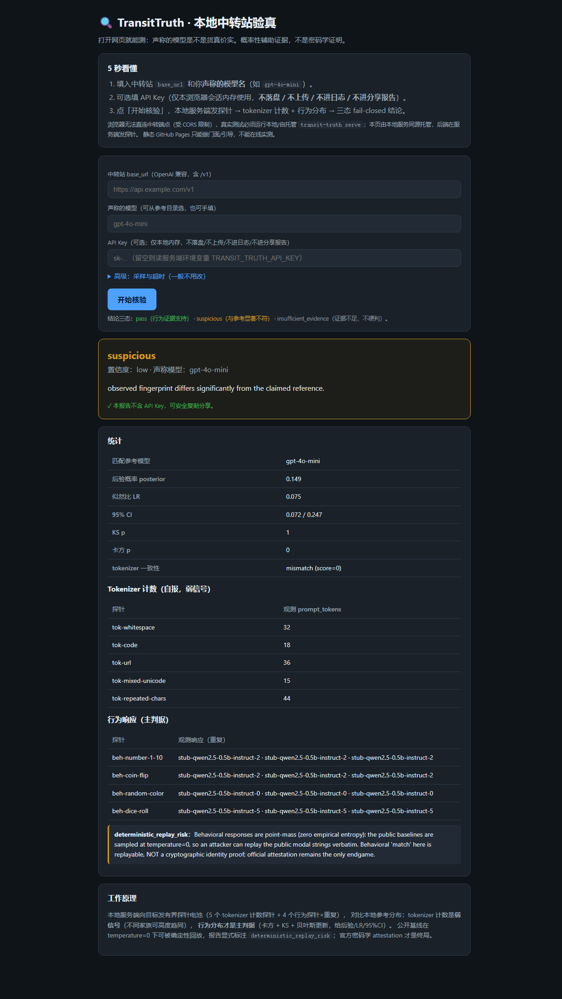

# TransitTruth 🛡️

[English](README.en.md) · [中文](README.md) · [日本語](README.ja.md)

[](https://github.com/dafahaha/transit-truth/actions/workflows/ci.yml)




**APIリレーで `gpt-4o-mini` の料金を支払っているとして、本当にそのモデルが返ってきていますか？**
TransitTruthは、任意のOpenAI互換エンドポイントに対して限定的なフィンガープリントプローブ群を実行し、エンドポイントが提供を主張しているモデルが参照フィンガープリントと一致するかを単一のJSONレポートで示す、ステートレスなCLIです。同じ検査を手元のブラウザから実行できるローカル単一ページWeb UI（`transit-truth serve`）も同梱しています。

LLMセキュリティ研究者、エージェント開発者、サードパーティ製リレーやゲートウェイ経由でLLMトラフィックをルーティングするすべての人のためのツールです。

### 30秒でわかる概要

- **何に答えるか：** `gpt-4o-mini` の請求を受けているが、エンドポイントが実際に返しているのはそのモデルか。OpenAI互換エンドポイントを渡すと、限定的なプローブ群（論理プローブ17個。一時的な失敗時のみ再試行し、既定で各最大3回まで追加。最悪ケースは17×4＝68 HTTP呼び出し。`MAX_RETRIES` 環境変数で減らせる）を実行し、単一のJSONレポートを返します。
- **何が得られるか：** `pass` / `suspicious` / `insufficient_evidence` の三態、信頼度、その根拠。証拠が足りなければ「足りない」と明示します。
- **何を主張しないか：** 暗号学的証明ではなく、確率的な補助証拠です。同梱参照セットは小さく（Qwen2.5とGLM-4-9B-Chatのtokenizerフィンガープリント、および単一中継リレー経由のGPTベースライン）、公開された `temperature=0` のプローブ群はハードコードして再生できるため、レポートは `deterministic_replay_risk` を立て、信頼度を low に制限します。完全な限界は後述の「正直な限界」にあります。

> **スコープ注記。** 現在の `verify`/`serve` 経路（PyPI向けのコードパス。未公開）は**ステートレスなモデル同一性検証**（CLI/SDK＋ローカル `serve` ブラウザUI。キーはセッションメモリのみ）です。トークン課金監査（tiktokenによる課金差分検出）、レイテンシ/可用性/エラー率の性能監視、OpenAI応答フォーマットのプロトコル準拠、残高照会/低残高アラート、継続監視/アラートチャネル、コミュニティランキング/オンライン投稿は、**初期の独立したレガシーWebプラットフォーム（`app.main`、別途セルフホスト）**に属し、現在の `verify`/`serve`/PyPIバンドルには**含まれません**。

---

## 🌐 ワンクリックオンライン検査（インストール不要、ページを開くだけ）

Pythonは不要です。GitHub Pagesのビルドを開き、自分のリレーのBase URL（任意で一時的/低クォータのキー）を貼り付けると、**ブラウザが入力したエンドポイントと直接通信**し、到達性/プロトコル/基本能力の疎通検査を、フェイルクローズドな三態レポートで返します。キーはページメモリ内だけに存在し、自分のエンドポイントへ直接送られます。**本プロジェクトのサーバには一切触れず、保存されず、URLにも入らず、ログにも残りません**。

**オンラインURL:** <https://dafahaha.github.io/transit-truth/docs/online/index.html>





**先に読むべき限界：** ブラウザはCORS制約を受けるため、ほとんどのリレーはWebページから読めません（ページはCLI/ローカルserveを使うよう正直に案内します）。またブラウザには行動参照分布がなく、tiktokenのBPEカウントも実行できないため、**オンラインビルドは決して `pass` を出しません**。完全な行動フィンガープリント＋tokenizer統計には、ローカルの `transit-truth serve` / CLIが必要です。オンライン出力は確率的な補助証拠であり、暗号学的証明ではありません。

---

## クイックスタート

> **PyPIはまだ公開されていません。** 現時点ではPyPIからの
> `pip install transit-truth` は存在しません（今日実行すると404になります）。
> 事前ビルド済みwheelをGitHub Releaseから直接インストールしてください
> （クリーンなvenvで検証済み。gitもローカルビルドも不要）：

```text
pip install https://github.com/dafahaha/transit-truth/releases/download/v0.5.9/transit_truth-0.5.9-py3-none-any.whl
transit-truth --help   # 8つのサブコマンドが表示されるはず
```

**バージョンに関する注意**：このwheelはタグ `v0.5.9`（`e8558a1`）からビルドされ、`main` より27コミット遅れています。本書に記載された修正と401 passedは含まれません。現在のソースを入れたい場合は下のアーカイブを使ってください。wheelはリリースビルドを再現したい場合にのみ使います。

Releaseのダウンロードがブロックされる場合は、リポジトリのアーカイブに退避してください：

```text
pip install "https://github.com/dafahaha/transit-truth/archive/refs/heads/main.zip"
```

テスト数を再現するには、ソースツリー（`git clone` または解凍したアーカイブ）で `pytest backend/tests/` を実行してください。`pip install` はランタイムパッケージのみを同梱し、`backend/tests/` は含みません。

ソースを編集したい場合はcloneします：

```text
git clone https://github.com/dafahaha/transit-truth.git
cd transit-truth
python -m venv .venv
# 有効化:
#   bash / macOS / Linux: source .venv/bin/activate
#   Windows PowerShell:   .venv\Scripts\Activate.ps1
pip install .
# セルフホストreference-serverの本物のローカルtokenizerを使う場合
# （このextraがない場合、後述のキー不要パスは正直な配管用スタブに縮退します）:
pip install ".[reference]"
```

> **Python 3.10+ が必要**（3.10–3.13でテスト済み）。インストール後、
> `transit-truth` コマンドがPATH上にあるはずです（Pythonの
> `Scripts`/`bin` ディレクトリに入ります）。シェルが見つけられない場合は、
> ターミナルを開き直すか、venvを有効化するか、モジュールを直接呼び出してください：
> `python -m app.cli --help`。

<!-- PYPI-FLIP: このブロックは、パッケージが実際にPyPIに載った後でのみ
`pip install transit-truth` + `pip install "transit-truth[reference]"` に戻す。 -->


リレーと、それが提供を主張するモデルを指定します。APIキーは環境変数から読み取られ、ディスク、ログ、レポートには一切触れません。

```bash
# bash / macOS / Linux
export TRANSIT_TRUTH_API_KEY=sk-your-key
transit-truth verify --base-url https://your-relay.com/v1 --model gpt-4o-mini
```

```powershell
# Windows PowerShell（この行を実行）
$env:TRANSIT_TRUTH_API_KEY="sk-your-key"
transit-truth verify --base-url https://your-relay.com/v1 --model gpt-4o-mini
```

標準出力は機械可読な単一のJSONレポートです：

```json
{
  "claimed_model": "gpt-4o-mini",
  "verdict": "pass",
  "confidence": "medium",
  "statistics": {
    "matched_reference_model": "gpt-4o-mini",
    "posterior": 0.87,
    "tokenizer_consistency": {"score": 1.0, "verdict": "match"}
  },
  "disclaimer": "Probabilistic auxiliary evidence, NOT a cryptographic proof."
}
```

終了コード：`0` はクリーンな `pass` のみ。`2` は非pass（エラーレポート**または** `insufficient_evidence`）、**かつ** argparseの使用エラーも `2`（argparseの既定）。`3` は `suspicious`。`1` は他コマンドの未回復のランタイムエラー、およびサブコマンドなしで `transit-truth` を実行した場合（ヘルプを表示して1で終了）。スクリプトは終了コードではなくJSONの `verdict` フィールドで判定してください。

## ローカルWeb UI（`transit-truth serve`）

クリック操作で検査するには、ローカルサーバを起動してブラウザを開きます：

```bash
transit-truth serve                 # 既定 http://127.0.0.1:8766
transit-truth serve --open          # ブラウザを自動で開く
```

UIは単一のローカルプロセスから自身と `POST /api/verify` エンドポイントを提供し、サーバがプローブ群を実行します。リレーの `base_url`、主張モデル（カタログから選ぶか入力）、任意でキー（パスワードフィールド）を入力します。レポートのバナーには三態判定、信頼度、posterior / LR / 95% CI / カイ二乗 / KS p、プローブごとの証拠、フラグ（`deterministic_replay_risk`、`thin_evidence`、`non_cooperation`）が表示されます。

**ローカルWeb UIのスクリーンショット**（ローカルの `transit-truth serve` をローカルスタブバックエンドに対して実行して撮影。実キーなし。レポートにキーは含まれません）：

| ホームフォーム | pass（行動証拠が支持） | insufficient_evidence（証拠不足、判定を強制しない） | suspicious（参照と有意に異なる） |
| --- | --- | --- | --- |
|  |  |  |  |

### キー安全管理（ハード契約）

- キーはセッション中**メモリのみ**に存在します。ディスクに書かれず、ログ（uvicornのアクセスログを含む）にも残らず、応答にエコーされず、共有可能なレポートにも現れません。
- 多層防御の `sanitize_report` が、返信前に資格情報フィールド（`api_key / authorization / bearer / key`）を再帰的に除去し、`sk-...` / `Bearer ...` 文字列をマスクします。レポートページにはキーが含まれず、安全に共有できると明記されます。
- 既定のバインドは `127.0.0.1`（ループバックのみ）。非ループバックアドレス（`0.0.0.0`、`::`、RFC1918、公開IP、ホスト名）へのバインドには明示的な `--allow-public` フラグが必要です。サーバはさらにsame-origin、`Sec-Fetch-Site`、Content-Type（`application/json` のみ）、および（ループバック時）Hostホワイトリストを強制し、DNSリバインディングとクロスサイト呼び出しを遮断します。

### ホスト版Pagesが実リレーを検査できない理由（CORS）

静的GitHub Pages上のブラウザは、サードパーティ製リレーを直接呼び出せません。リレーがCORSヘッダを返さないため、要求は曖昧な `Failed to fetch` で失敗し、そもそもブラウザにキーを対象ドメインへ送らせるべきではありません。**実際のモデル同一性検証は、ローカル/セルフホストの `serve` サーバ（またはCLI）経由で実行する必要があります**。プローブを送るのはブラウザではなくサーバだからです。

### デプロイ境界（正直に）

- **Docker / VPS:** `Dockerfile.serve` + `docker-compose.serve.yml` はホストの `127.0.0.1:8766:8766` のみを公開します。公開VPSでは手前にCaddy/Nginx + TLSを置いてください。コンテナは自身のプライベートネットワーク名前空間内で `0.0.0.0` を listen します（dockerブリッジはeth0に到達し、コンテナのループバックには到達しません）。露出境界はホスト側に残り、`0.0.0.0:8766` を公開してはいけません。
- **Cloudflare Pages / GitHub Pages** は静的なフロント/ガイドしかホストできません。**Cloudflare WorkersはV8アイソレート上で動作し、Python検証エンジン（tiktoken、scipy、非同期バッテリ）を実行できません**。ライブバックエンドにはPython対応のVPSまたはコンテナが必要です。統計なしでプローブだけを転送する薄いJSプロキシは本リポジトリでは実装されておらず、主張もしていません。
- ネットワークモデル、トラブルシューティング、公開ホスティングの責任（キーをログに残さないこと）については [docs/serve.md](docs/serve.md) を参照してください。

### 有料キーがない場合：パイプライン全体をローカルで実行

セルフホストのOpenAI互換参照バックエンドを同梱しています。verifyクライアントは空でないキーを要求するため、ダミー値を設定します：

```bash
# bash / macOS / Linux
export TRANSIT_TRUTH_API_KEY=local-dummy-no-billing   # 課金なし、ローカルのみ
```

```powershell
# Windows PowerShell
$env:TRANSIT_TRUTH_API_KEY="local-dummy-no-billing"
```

```text
# ターミナル1: ローカル参照バックエンド（実際のQwen tokenizerカウント、
# 決定論的スタブ内容。実モデルなし、GPU不要）
transit-truth reference-server --model qwen2.5-0.5b-instruct --port 8765

# ターミナル2: 自身に対して検証（1行で実行。バックスラッシュ継続なし）
transit-truth verify --base-url http://127.0.0.1:8765/v1 --model qwen2.5-0.5b-instruct --allow-local
```

ループバック対象には `--allow-local` が必要です。既定では公開URLのSSRFガードを強制します。実際のtokenizerをダウンロードできない場合（`HF_ENDPOINT` の既定は `https://hf-mirror.com`）、reference-serverは明示的にラベル付けされた配管用スタブに縮退します。stderrのバナーと `GET /v1/models` の `mode` フィールドが大声でそう告げ、何も証明できません。

**この自己検査が*本来*出力すべきもの（本物の結果をバグと誤認しないため）：**

| セットアップ | reference-serverモード | verify判定（終了コード） | 理由 |
|---|---|---|---|
| 素の `pip install .`（`[reference]` なし） | 正直な配管用スタブ（ハッシュプレースホルダの `prompt_tokens`、固定の行動文字列） | **`suspicious`（終了3）** | プレースホルダのカウントは、実際のQwen参照値と意図的に一致しない |
| `pip install ".[reference]"`（tokenizerをダウンロード可能） | 本物のローカルtokenizer。行動内容は依然として決定論的スタブ | **`insufficient_evidence`（終了2）** | tokenizerカウントは一致するが、オープンソースカタログに行動分布がないため、何も証明できない |

この自己検査の目的は、**パイプラインがエンドツーエンドで動作し、決して偽の `pass` を報告しないことを証明する**ことであり、`pass` を*得る*ことではありません。ここでの `suspicious` はフェイルクローズドで正しい動作です。このローカルループバック構成で `pass` が見えたら、それはバグです。

ポートが誰も受け付けないbase-urlは、約5秒で `error.code = "endpoint_unreachable"` として即失敗するようになりました（90秒のバッテリタイムアウトを消費して `battery_timeout` と誤報告する代わりに）。

## 3つの判定

| verdict | 意味 |
|---|---|
| `pass` | 観測されたフィンガープリントが参照と統計的に整合している（行動証拠が支持。高信頼度にはposterior > 0.9 かつ95% CI下限 > 0.7が必要）。 |
| `suspicious` | 観測されたフィンガープリントが有意に異なる（例：モデル系列が違う。別系列へのtokenizer不一致もこれを引き上げる）。 |
| `insufficient_evidence` | 参照がない、サンプルが小さすぎる、tokenizer一致だけでは行動的裏付けがない、またはエンドポイントが協力を拒否した。**推測はしない**。 |

`suspicious` は「詐欺の証明」ではありません。より注意深く見る価値のある証拠です。

## 実際の動作

主張モデルが与えられると、既定のバッテリは限定的なtokenizerプローブ群（固定プロンプトスイートに対する自己申告の `usage.prompt_tokens`）と、行動プローブ×繰り返し（分布的な「ランダムタスク」選好——モデルが返す数、コイン投げ、色、サイコロ）を送信します。観測されたフィンガープリントを、カイ二乗/KS検定とベイズposteriorを使って同梱の参照カタログと比較し、単一のレポートを返します。公開価格が低い場合、フル実行の推定コストは0.01ドル未満です。実際のコストはモデル階層とトークン単価に依存します（コードに価格計算ロジックはありません）。

### 同梱参照データが示すもの

最初のカタログ（gpt-4o / gpt-4o-mini、各プローブn=50、単一のサードパーティリレー経由で収集。公式エンドポイントではない）の数値：

- 「ランダムな動物を選べ」という行動プローブで、gpt-4oは**76%**の確率で「Okapi」を返した（一様選択なら約16%）。
- 単純な「答えはOkapiか」ルールは、同じベンチマークサンプル上で**88%の再代入精度**を達成した（Wilson 95% CI [0.80, 0.93]）。これは**分布内再代入**の自己整合性チェックであり、**ホールドアウト精度ではない**。
- 最強の行動プローブ（ランダム動物）は**TVD = 0.90**に達する。これは分布距離であり、分類精度ではない。
- エンドツーエンドパイプラインの自己整合性posteriorは**0.913**（95% CrI [0.885, 0.937]）。これもカタログ自身の分布内参照に対して測定されたもので、独立したホールドアウトデータではない。

これらは参照フィンガープリントとして同梱されます。ツールはホールドアウト汎化やベンダー非依存の検出を意図的に主張しません。

## 正直な限界

判定を信頼する前にこれを読んでください。

- **確率的な補助証拠であり、暗号学的証明ではない。** ブラックボックスのフィンガープリントは偽造できる。プロバイダ署名付き応答（公式attestation）だけが終局です。arXiv:2504.04715（Berkeley）は代わりにTEEベースの暗号学的完全性attestationを提案しています。これは形式/ハードウェア経路であり、商用フィールド測定ではありません。本ツールは安価で反復可能なスクリーニング層であり、法廷の証人ではありません。
- **カバレッジは設計上狭い。** 現在同梱される参照：
  - `gpt-4o-mini` と `gpt-4o` — **単一のサードパーティリレー（wolfai.top）、公式OpenAIエンドポイントではない**経由で収集したn=50ベースライン。主張するのは、そのリレーにおいてこれら2つの命名エンドポイントが区別可能だったことだけであり、ベンダー非依存のフィンガープリントではない。
  - Qwen2.5-0.5B-Instruct — 本物のローカルtokenizerカウントのみ。**行動分布なし**のため、単独で `pass` を出すことは決してできない。
  - GLM-4-9B-Chat — 本物のローカルtokenizerカウント（7プローブ）。**行動分布なし**のため、単独で `pass` を出すことは決してできない。
  - DeepSeek-R1-Distill-Qwen — Qwen2 tokenizerを派生。カウントではQwenと区別できない。
  - Claude / Gemini / その他GPT主張の閉源フィンガープリントは、自分のキーで収集する必要がある。
- **tokenizer信号の正確な意味。** **行動参照のないtokenizer一致**は同系列であることだけを意味し、`insufficient_evidence` が上限（`pass` には決してならない）。**tokenizer不一致（誤系列）**は `suspicious` を引き上げ、矛盾を避けるためposterior/LR/CI/カイ二乗をゼロにする。tokenizer信号の欠落、または公開された最頻文字列だけを再生するpass/lowは、エンドポイントが公開フィンガープリントを再生できることだけを証明し、**実モデルの確認とは等しくない**。本物のモデル主張は、高信頼度での十分な行動証拠に依存する。
- **temperature=0の点質量再生リスク。** 同梱の行動ベースラインは退化分布である（例：gpt-4o-miniは「1–10から数を選べ」に対して毎回「7」を返す）。プローブプロンプトとベースラインはこの公開リポジトリに同梱されているため、攻撃者は約4つの公開最頻文字列をハードコードし、行動的「一致」を決定論的に再現できる。レポートはまさにこれに対して `deterministic_replay_risk` を立て、信頼度を `low` に制限する。
- **tokenizerカウントは弱い自己申告信号。** リレーは報告する数値を制御できる。異なる系列が公開プローブ上でほぼ同一になることもある（Qwen2.5とo200kは5プローブ中4つで一致）。行動証拠が主たる判定者であり、tokenizer一致だけでモデル系列を推論してはいけない。
- **ε-希釈。** トラフィックの一部だけを偽モデルにルーティングするリレーは、小さな予算では検出が難しい。`app.verify.sequential.budgeted_sequential_analysis(epsilon, budget)` は、自分の予算で何を捕まえられるかを見積もるのに役立つ。

完全なレポート契約は [docs/verify.md](docs/verify.md)、方法論と脅威モデルは [docs/tech_report.pdf](docs/tech_report.pdf) を参照してください。

## Python SDKと可観測性

```python
from app.verify import verify_endpoint_sync

report = verify_endpoint_sync(
    base_url="https://relay.example/v1", claimed_model="gpt-4o-mini"
)
```

任意：OpenTelemetry / OpenInferenceエクスポーター、DeepEvalメトリクス、Langfuseスコア統合が [`examples/`](examples/) 以下にあります。

## CLI以外のリポジトリ構成

このリポジトリには、それが育ってきた広範な監査プラットフォームも残っています。これらの機能は**レガシーで別途セルフホスト**であり、現在の `verify`/`serve`/PyPIモデル同一性経路には同梱されません：

- **オフラインブラウザデモ（ルート `index.html`）：**
  https://dafahaha.github.io/transit-truth/ — 監査フローをデモ用シードデータで示す、オフラインの組み込みイラスト。キー不要で、実リレーのライブ測定ではありません。実際のモデル同一性検証は `transit-truth serve` / CLI を使います（上記CORS注記参照）。
- **ローカルverify Web UIの実行：** `transit-truth serve`（既定 127.0.0.1:8766。[docs/serve.md](docs/serve.md) 参照）。
- **レガシーWebプラットフォームの実行（ソースチェックアウトのみ。PyPI wheelには `app.main`/`app.api` が含まれません）：**
  このリポジトリを `git clone` し、`cd backend && pip install -r requirements.txt && uvicorn app.main:app --port 8000`。
  このレガシープラットフォームには残高照会集約、継続監視/アラート、コミュニティランキングが含まれます。`verify`/`serve`/PyPIには同梱されません。**公開バインドのリスク：** 既定はループバックです。公開インターフェースで露出するには明示的な `--allow-public` が必要で、認証、露出、キー衛生の責任は自分にあります。認証なしで公開してはいけません。レガシーの `docker-compose.yml` + `Dockerfile`（同じレガシーAPI、認証なし）は `Dockerfile.serve` / `docker-compose.serve.yml` に**置き換えられました**。ホストの `127.0.0.1:8000` のみを公開し、LANや公共インターネットに露出してはいけません。
- **Docker:** `docker compose -f docker-compose.serve.yml up -d --build`（ホストループバックのみ。[docs/serve.md](docs/serve.md) 参照）。
- **ベースラインデータ:** `data/baselines/`（実n=50コレクション）、`data/fingerprints/`（オープンソースtokenizerカタログ）。
- **テスト:** 401 passed / 7 skipped（408 collected。7 skippedは実APIキーが必要な統合テスト。`pytest -m integration` で実行）。

## ソースからのインストール（PyPIリリース前）

```bash
git clone https://github.com/dafahaha/transit-truth.git
cd transit-truth
pip install .
# reference-serverで本物のローカルtokenizerを使う場合:
pip install ".[reference]"
```

`data/baselines/` または `data/fingerprints/` を変更した場合は、wheelをビルドする前に `python sync_reference_data.py` を実行してください。インストールされるパッケージには、そのカタログのミラーが含まれます。

## コントリビューション

IssueとPRを歓迎します。初心者向けIssueには
[`good first issue`](https://github.com/dafahaha/transit-truth/labels/good%20first%20issue)
タグが付いています：新しいオープンソースモデルのtokenizerフィンガープリント追加、OTelエクスポーター例、翻訳ドキュメントなど。[CONTRIBUTING.md](CONTRIBUTING.md) と
[CODE_OF_CONDUCT.md](CODE_OF_CONDUCT.md) を参照してください。

リレーを監査したら、結果を
[Discussions → Show your audit results](https://github.com/dafahaha/transit-truth/discussions)
に投稿してください。

## 引用

```bibtex
@misc{transittruth2026,
  title  = {TransitTruth: Stateless Verification of Model Identity for OpenAI-Compatible Endpoints},
  author = {dafahaha},
  year   = {2026},
  howpublished = {\url{https://github.com/dafahaha/transit-truth}},
}
```

## 免責事項

研究用ツールです。結果は統計的証拠であり、法的証明ではありません。対象サービスの利用規約を尊重し、エンドポイントを叩き続けないでください。本プロジェクトはOpenAI、Qwen、その他モデルプロバイダと提携していません。

## ライセンス

MIT — [LICENSE](LICENSE) を参照。

---

日本語訳の初版は @SakarPaisen（PR #7）。現在の完全版はメンテナが `README.en.md` に同期し、テスト数・GLM フィンガープリント・wheel の注意事項を更新したものです。
